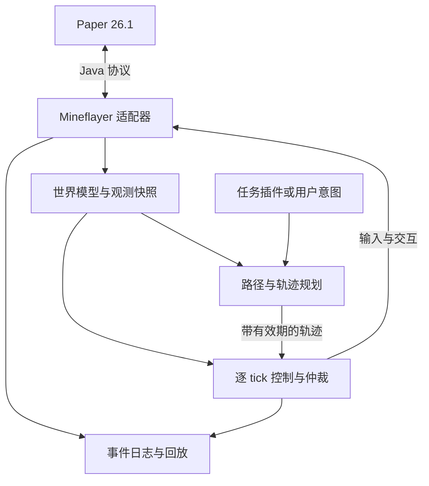
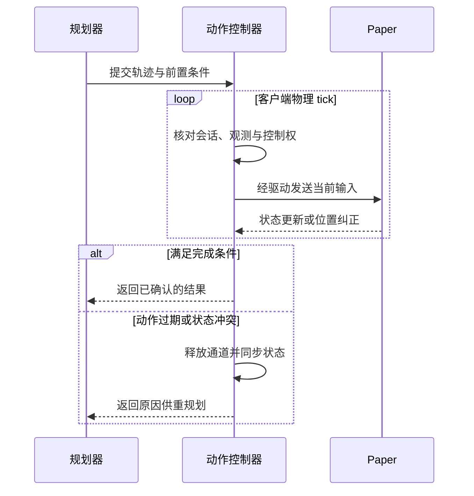
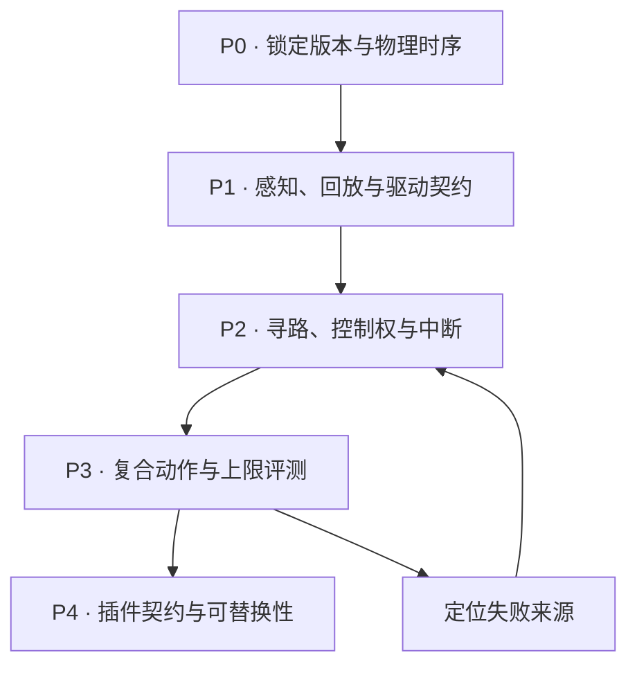
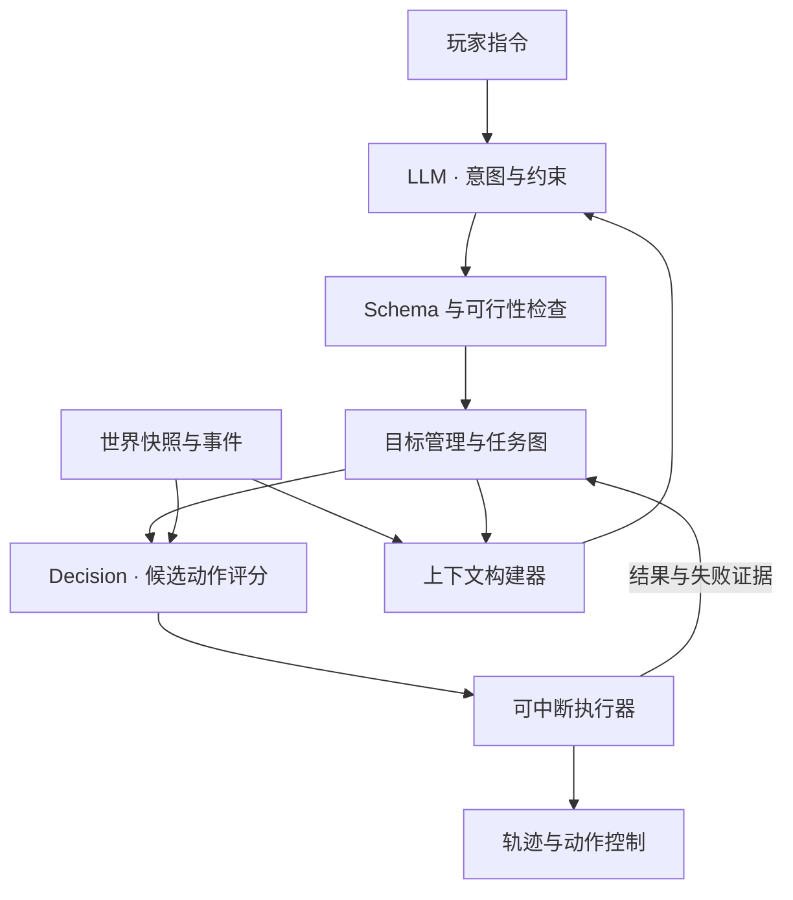

# Minecraft Java 26.1 通用 Bot 技术设计

v0.5 · 2026-11-17

## 1. 范围与目标

在自建或授权的 Paper 26.1 服务器上实现可复用的 Bot 运行时。首要目标是验证动作上限：能否在连续移动中同时处理视角、跳跃、物品栏和交互，遇到延迟或服务器纠正后仍能稳定恢复。用固定地图、可重放输入和独立服务端采样作为验收夹具。业务玩法通过插件接入。

首版使用协议感知。接口为真实 Java 客户端、画面感知和 Paper 插件事件预留扩展点。上限分三项分别度量：物理可达性、连续动作可靠性、多人或动态环境中的重规划速度。拟人度另外与人工录像比较转向、停顿与动作衔接。

## 2. 运行时拓扑



主进程持有客户端连接和动作状态。规划任务通过有界队列交给 Worker Threads。Worker 使用局部快照，返回结果附带维度、会话代数、世界修订号和相关区块版本。主进程逐项检查依赖；无关区域发生变化时仍可接受结果。模型、磁盘写入和插件计算均由异步路径处理。动作环采用有界运算，落后时取消过期指令并从当前观测恢复。在线记录单调时间、输入与调度事件、Worker 结果完成及接纳顺序、超时、模型响应和随机种子；回放时注入虚拟时钟驱动记录事件，以区分决策重放与算法重算。

## 3. 技术选型

- **服务端**。Paper 26.1 + Java 25。开发和 CI 使用 Docker Compose、固定种子与地图夹具。锁定精确服务端构建、客户端依赖和运行时版本。
- **客户端**。Node.js 24 LTS + TypeScript strict + pnpm lockfile。首选 Mineflayer，由其承担协议、会话和现有物理驱动。使用 minecraft-data / Prismarine 注册表解析方块、物品和实体；直接协议扩展封装在驱动内部。
- **算法与并发**。TypeScript 实现规划器和控制器，Node Worker Threads 承载地图搜索。小地图先测基线，热点由 CPU profiling 指导优化。
- **契约与测试**。Zod 验证外部意图和插件配置，Vitest 做单元与回放测试，Docker Paper 做端到端测试。Pino 或等效结构化日志输出 NDJSON，关键时序以单调时钟记录。
- **可选扩展**。Paper 桥接使用 Java 25、Gradle 和 Paper API，提供授权、版本化的玩法事件。高层模型通过独立意图适配器接入，可更换供应商。首轮用确定性指令和测试夹具驱动。

Mineflayer 上游列出 26.1 支持，Paper 文档列明 26.1+ 使用 Java 25。确切构建组合仍需验证登录、注册表、方块碰撞、容器和重连。基线以实测通过的锁文件和镜像为准。

## 4. 感知与世界建模

1. 驱动将协议事件归一化，附加 `sessionEpoch / dimension / seq / observedAt`。递增的本地事件序号用于回放；分别标记客户端本地模拟、服务端校正和测试服独立采样，记录各自时间戳及可取得的回执与延迟。测试服独立采样只用于验收，不提供给在线决策额外信息。服务端采样用于核对服务器执行结果；与原版物理行为比较还须记录原版客户端的输入及状态。
2. 以区块为单位缓存方块状态和碰撞形状。导航缓存使用区块 revision 增量失效。未加载区块为未知，搜索仅在已知可达边界内提交动作。
3. 对视角使用视锥筛选和 voxel DDA 射线遍历，结合碰撞盒判定遮挡；视锥用于仿人感知，交互射线用实际命中盒和交互面验证。协议观测、可见观测和推断值分别标注来源。
4. 动态实体先使用固定窗口的匀速估计，使用观测残差和数据年龄缩短预测有效期。传送、重生或观测间断时重置估计。保留可选视觉与插件观测源，其数据同样携带时间、置信度和权限范围。
5. 坐标系、角度、碰撞与状态单位在驱动边界归一化。服务端校正、维度切换与重连会触发控制器重新同步。

## 5. 规划与动作控制

### 5.1 全局寻路

用 **A\*** 作为基线。节点用可站立位置和必要的姿态表示。基线边要求末端实际静止后才算抵达安全路点，须将制动距离与时间纳入边验证；朝向若影响动作建边，也须规范化并纳入节点键。边由走、跳、落和跨越等物理动作生成，检查身体净空、落脚面与风险条件。代价综合预计 tick、危险、视角切换和资源消耗；启发式取位移耗时下界。固定搜索预算，目标跨未知区块时先到可见前沿。区块变化优先局部重搜，记录规模和耗时后再评估分区导航或 D* Lite。

Mineflayer Pathfinder 作为 P1 对照实现，用来比较路线覆盖与控制复杂度。回合内保持一个动作写入者，参考模块通过适配层进行独立测试。核心寻路器输出带前置条件的动作段，并由统一控制器执行。基线寻路统一从静止状态建边，并验证每段末端制动至静止后才能交接；若要规划连续跳跃等依赖动量的动作，节点必须包含影响可达性的速度与朝向状态，不能依赖局部搜索补回已被全局搜索合并的状态。

### 5.2 局部轨迹与动作上限

采用**有限时域动作采样 + 滚动重规划**。从候选转向、移动键组合和起跳时机生成短动作序列，以已校准的碰撞和移动模型前向预测。优先复用并验证 Prismarine 物理层。初始可用 6–12 tick 的滚动窗口，按落点误差、速度、风险及操作约束评分。每 tick 下发当前输入，观测偏差超阈值或碰撞环境变化时重算。采样数量和预算可调，通过 P3 基线确定默认值。

视角控制沿 yaw 最短角路径，限制角速度与加速度；交互帧校验距离、命中面、手持物和相应前置条件。长按移动与单次交互分别建模。物品栏、容器、放置等采用“提交 → 观察结果 → 确认或恢复”状态机。超时先读取当前状态，避免重复消耗或重复点击。

### 5.3 tick 时序与取消



约 20 Hz 是标称频率。P0 用驱动探针验证物理 tick 与按键应用的实际顺序。移动、视角、主手和容器声明为独占通道，组合动作一次申请全部所需通道；租约另标记为可抢占或不可抢占。与现有可抢占租约冲突的新候选仍参与评分；先确认全部所需通道可取得，再原子撤销旧租约并授予新租约，条件不满足时不执行交接。已撤销租约的迟到帧和交互均被拒绝。停止、断线和高优先级抢占必须清空持续按键，淘汰旧会话轨迹；已提交交互的副作用不能撤销，只能等待结果并重新同步。

## 6. 可插拔接口

### 核心数据契约

```ts
interface ClientDriver {
  readonly capabilities: ReadonlySet<string>
  subscribe(emit: (event: Observation) => void): () => void
  apply(frame: InputFrame, lease: ControlLease): void
  interact(request: InteractionRequest, lease: ControlLease): Promise<InteractionOutcome>
  releaseInputs(): void
}

interface Planner {
  plan(request: PlanRequest, signal: AbortSignal): Promise<PlanResult>
}

interface BotPlugin {
  readonly manifest: PluginManifest
  start(ctx: PluginContext, signal: AbortSignal): Promise<void>
}
```

- **驱动接口**。把协议事件和输入统一成内部类型。交互结果带 observed / rejected / timedOut / uncertain 等状态和证据。实时帧 API 必须验证控制租约并只由动作控制器调用。
- **感知扩展**。注册 `ObservationSource` 产出带来源的观测，由世界模型合并。通过契约测试验证维度切换、乱序、过期和观测冲突。
- **规划扩展**。注册 `Planner`，输入为目标、只读局部快照、预算和动作能力，输出轨迹、所依赖的修订号或结构化失败原因。轨迹的运动状态边界必须符合对应寻路阶段的约定。
- **任务插件**。通过版本化 manifest 声明 API 版本、能力依赖、事件订阅和意图 schema。上下文只提供只读观测、意图提交、结果订阅与配置。玩家和模型均走同一个意图入口。取消由 AbortSignal 和会话代数传递，插件退出后撤销订阅和未执行意图。
- **加载与隔离**。首版启动时加载白名单插件，版本不兼容时说明原因。进程内 TypeScript 插件只用于可信代码，Worker Threads 用于 CPU 卸载；需要执行第三方插件时再通过进程隔离和受限 IPC 实现权限边界。
- **契约测试**。用空实现、记录回放驱动和可预测的规划器做测试夹具，验收可替换性、能力拒绝、超时与取消；回放区分按已记录规划结果重放决策和固定随机种子、稳定排序及扩展预算下重算算法。业务技能通过相同接口独立开发。

建议工程布局为 `packages/contracts`、`packages/client-mineflayer`、`packages/world`、`packages/planner`、`packages/controller`、`apps/bot` 与 `tests/scenarios`。

## 7. 实施计划与验收



### P0 · 版本和动作探针

建立 Paper 26.1 + Java 25 的可复现环境。验证登录、注册表、区块、物品栏、标准交互、重连和物理 tick 顺序。用测试服独立采样记录服务器执行与校正，并记录原版客户端和 Mineflayer 在同一地形、相同输入下的移动、起跳与落点数据；服务器采样不能替代原版客户端物理对照。验收以锁定构建和可重复运行的探针日志为准。

### P1 · 驱动、观测与回放

实现驱动契约、局部世界模型、视线与回放工具。在线日志包含单调时间、输入、调度事件、Worker 结果完成及接纳顺序、超时和模型响应；回放注入虚拟时钟驱动记录事件。决策重放使用已记录的规划结果；算法重算使用固定随机种子、稳定排序和固定扩展预算，避免墙钟负载决定搜索结果。覆盖区块卸载、维度切换、连接重置以及过期观测。用标准交互校验请求与服务器反馈关联。

### P2 · 寻路与实时执行

实现 A*、碰撞动作边、轨迹验证、视角控制和通道仲裁。基线边从静止状态出发，并实测末端制动距离/时间，确认实际静止后才交接；若朝向影响建边则规范化并纳入节点键。若纳入依赖动量的连续动作，搜索键须包含影响可达性的速度与朝向状态。夹具包括平地、转角、高差、狭窄落脚点、墙后已知目标导航、背后转向、视线不成立时拒绝交互及运行中障碍更新。逐用例记录到达率、规划耗时、位置纠正和取消耗时。已过期的轨迹应被拒绝，取消后应在下一次调度释放持续输入；验证组合动作全通道交接、普通高优先级任务抢占、可抢占租约原子交接及旧租约迟到写入被拒绝。

### P3 · 复合动作与能力上限

通过测试驱动组合移动、视角、跳跃、切槽、交互和反馈，跑固定路线并与人工基线对照。分开记录客户端物理预测、服务端实际执行/校正、测试服独立采样；独立服务端采样仅用于验收，不作为在线决策额外信息。在相同夹具中对比原版客户端输入和状态，避免以 Mineflayer 自己的模拟输出作为校准真值；加入同一格点分别以静止和助跑状态到达、导致后续跳跃可达性不同的用例，验证搜索状态键保留差异。测试分本地、注入约 80 ms RTT、注入抖动三组，分别记录结果。初始目标为本地固定场景每组 50 次、成功率至少 90%，控制计算 p95 小于 5 ms；另报告 tick 间隔、交互确认延迟、服务器纠正率和失败分类。门槛是待校准的工程目标。

### P4 · 插件与适配器验收

用两个测试插件分别提交相同意图，使用真实与回放驱动运行同一测试契约。验证缺失能力、坏参数、同通道竞争、可抢占/不可抢占租约、组合动作全通道交接、原子交接、旧租约迟到帧和交互、旧结果回传、插件退出和重连场景；已提交交互取消后应停止后续动作并等待结果，不能假定副作用已撤销。必要时实现一个带授权的 Paper 事件适配样例，验证协议感知与扩展数据可以并存。

## 8. 决策点

- 若 Mineflayer 位移和人工基线差异影响复合动作，先用轨迹日志确认是物理预测、输入调度还是服务端纠正，再决定修正驱动或引入真实客户端适配器。
- 若固定延迟下仍高频失败，按输入时序、落点偏差、交互可达性和回执时延拆解，逐项调整预测窗口与动作预算。
- 若远距导航超出规划预算，再引入分区导航；若频繁局部变化主导耗时，再评估增量搜索。
- 若目标机制只有渲染可见，先验证可提取的标准协议数据，随后比较 Paper 事件或视觉输入。为每种观测源单独评估准确性与延迟。


## 9. Decision 与 LLM 的完整分层

这一层负责把玩家目标转成持续可执行的任务，并在环境变化时选择继续、暂停、重试或重规划。LLM 在目标解释、开放任务分解和对话上提供能力。确定性的执行器负责前置条件、资源占用、超时与结果确认。



### 9.1 目标、任务与执行状态

目标保存 goalId、来源玩家、优先级、约束、终止条件、创建时间、截止时间和 revision。目标变更增加 revision，旧模型响应和旧任务图不再拥有提交权。会话代数负责连接生命周期，目标 revision 负责意图生命周期。能力 manifest 声明可见性前置条件与支持的观测来源；依赖已知或记忆位置的能力须声明来源及有效期。

任务图用 DAG 表示依赖。节点包含 capabilityId、类型化参数、依赖节点、前置条件、成功条件、所需资源及其可抢占性、时间预算、重试预算和取消策略。状态依次为 pending、ready、running、succeeded；异常进入 blocked、failed 或 cancelled。并行执行须通过资源仲裁。每个节点的输出和观测证据写入事件日志。

任务图的结构来自 LLM 或外部任务插件。运行时检查环路、参数、能力存在性、依赖合法性和可表达的成功条件。模型预测的效果仅作为计划假设，完成状态由观测检查器确认。失败后局部重规划优先保留已确认节点和仍然有效的依赖。

### 9.2 Decision 算法

采用“硬约束过滤 + Utility 评分 + 可中断状态机”的组合。先过滤能力不存在、不可抢占资源冲突、过期观测和不满足前置条件的候选。可见性由能力前置条件决定：导航、探索和转向可使用注明来源与有效期的已知位置或记忆；交互等动作在提交时验证当前视线、命中面与距离。与现有可抢占租约冲突的新候选仍参与评分，其是否能取得全部所需租约由仲裁器原子交接时确认。剩余候选按以下形式评分，所有项归一化到同一量级。

```text
score = progressWeight * expectedProgress
      + urgencyWeight * urgency
      + confidenceWeight * confidence
      - timeWeight * expectedTime
      - riskWeight * risk
      - switchWeight * switchingCost
```

权重由运行配置给定，先人工调参，通过固定场景比较任务完成率和动作切换次数。加入滞回阈值与最短持有时间，只有更优候选持续满足切换条件时才替换当前意图。紧急停止、死亡和失去可用落脚点等强制事件越过持有时间。租约交接先确认所有所需通道可取得，再原子撤销旧租约并授予新租约，条件不满足时不交接；驱动拒绝已撤销租约的迟到帧和交互。已提交交互不随租约撤销，等待反馈并重新同步。评分、过滤原因、租约交接和切换依据必须可回放。

Decision 初始在关键事件到达时立即计算，并以约 5 Hz 做兜底检查；模型规划在目标变化、能力缺失、持续失败或关键事实变化时触发。控制层保持约 20 Hz。周期仅为起始配置，最终按负载与游戏响应要求调整。

状态机负责一次执行的生命周期。行为树可作为插件实现方式接入，任务图仍是跨插件的任务依赖表达。首版用 TypeScript 显式状态与事件转换，保持取消和恢复逻辑可测试。

### 9.3 LLM 职责与工具接口

LLM 接收玩家原始请求、确认的目标约束、能力目录摘要和有预算的世界摘要，输出下面三种对象之一。

- **IntentProposal**。给出目标、参数、约束及需要玩家澄清的缺失字段。
- **PlanProposal**。给出候选任务图、所依赖的事实、计划有效期与预期结果。
- **DialogueResponse**。根据已确认状态解释进度、失败原因或协作需求。

模型通过只读工具查询局部状态、能力描述、任务状态和历史事实，通过提交工具提出目标或计划。提交经过校验并得到 accepted / rejected 和结构化原因。所有实际动作经过 Decision 和控制器的控制权检查。

工具调用使用明确的 JSON Schema，运行时以 Zod 验证。参数限制包括数量、坐标范围、文本长度和可访问的会话。一次规划回合设置最大工具调用数、输入输出 token 预算和截止时间；达到预算时交还已有可验证结果。工具返回统一错误码和可恢复提示，模型可在剩余预算内修正参数。

### 9.4 上下文与记忆

按“玩家约束 → 当前目标 → 当前任务 → 相关观测 → 最近失败 → 可用能力”构建上下文。选取目标附近实体、当前路径涉及区块、相关物品和有限的近期事件，避免把整个世界缓存发送给模型。每条事实携带来源、时间和有效期。

首版用 SQLite 存储事件、目标、任务节点、已确认事实和会话摘要；采用 WAL 和异步批量写入，避免阻塞动作环。检索先按会话、目标、实体和位置精确过滤，再用 FTS5 检索文本。只有长历史检索测试显示收益时再引入向量索引。摘要保留其引用的事件范围，未知和推测有独立标记。

聊天、告示和插件文本作为带来源的环境内容输入。玩家控制权由会话身份解析器确认。角色提示词可以影响表达、主动程度与效用参数的允许范围，动作权限由运行时决定。

### 9.5 调用可靠性与模型选择

实现 ProviderAdapter，暴露 generateIntent、proposePlan、respond 和 cancel。内部统一请求 ID、目标 revision、超时、用量与错误类型。支持具备结构化输出或工具调用能力的模型供应商，具体模型在固定任务集上测延迟、合法输出率、计划可执行率与成本后锁定。

模型请求按目标去重，至多一个可提交的规划请求。新请求取消旧请求并增加请求序号，无法真正取消的网络响应在返回时被丢弃。限流与瞬时网络错误用有上限的指数退避和随机抖动重试；参数错误反馈修正，动作失败交给状态机。

模型不可用时，已验证且前置条件仍成立的动作可以完成，遇到需要新规划的节点转入 blocked。恢复后重新取快照。聊天输出和规划队列分别限流，避免连续聊天占用规划预算。

## 10. 底层技术路线的实施细节

### 10.1 世界模型的数据布局

方块按区块坐标索引，块状态保留 registry ID，碰撞查询从状态解析出形状缓存。规划快照只复制搜索范围内的必要数据，使用 TypedArray 和 transferable buffers 降低 Worker 消息成本。主线程保留其拥有的数据，转移的是专用于快照的副本。先实现复制版本，测出复制瓶颈后再考虑共享内存与同步协议。

实体表按 entityId 存位置、速度估计、观测时间、碰撞盒和可见性。背包使用 slot、itemType、count、components 和 revision 表达，组件差异参与物品等价判断。驱动记录每次世界与背包变更，规划器只读快照。

### 10.2 A* 的工程实现

开放集使用二叉最小堆，gScore、cameFrom 和关闭状态按节点键索引。基线阶段的边从统一静止状态出发，并在可安全停止的路点结束，节点键含维度、格点和姿态/运动模式。连续动作阶段若速度或朝向会改变同一格点的可达性，必须把相应离散化运动状态加入节点键与状态扩展；不能在全局搜索合并状态后仅靠局部轨迹搜索恢复被剪枝的路径。边包含起终状态与允许输入。

边生成器先做廉价几何检查，再对候选跳跃或落差执行物理预测。路径输出由路点、动作段和所依赖的区块 revisions 组成。实现最大扩展数、时间预算与取消点；部分路径只能提交到已验证的安全终点。启发式采用与代价单位一致的时间下界，加权启发式作为可选提速参数并明确其质量取舍。

### 10.3 局部预测的可计算实现

从当前输入、邻近转向和有限起跳时机生成动作候选，使用 beam search 限制每层保留数量。候选模拟包含位置、速度、姿态、碰撞结果和控制输入。初始设置作为实验参数，例如 8 tick 时域、beam width 16，依据延迟和成功率调节。碰撞、越界和落脚风险先做硬过滤，再计算落点偏差与时间等软代价。

Prismarine 物理能力必须通过 26.1 夹具校准。覆测台阶、半砖、液体、不同碰撞形状和服务器校正。分别记录本地预测、服务端校正与测试服独立采样；服务器结果用于验证服务端执行，原版客户端在相同输入与地形下的状态序列用于物理对照。不能用由同一模拟器产生的本地状态作为其预测真值。未通过验证的物理行为标记能力不可用，或将对应搜索边禁止。将预测与独立观测的位置误差记录为时间序列，用于判断问题来自模型、延迟还是控制时序。

### 10.4 输入调度和交互关联

控制器每轮读取最新快照、检查租约、选取有效轨迹帧，然后统一写入移动键和视角。驱动适配器验证调用时点，使帧在预期物理步生效。不要将本地定时器次数当作服务器 tick 编号。

对交互维护 pending 表，包含本地 requestId、窗口或位置、状态 revision、预期变化和截止时间。服务端事件缺少直接请求 ID 时，使用目标、前后状态和顺序匹配，并串行化同一容器的冲突事务。推断无法唯一关联时返回 uncertain，重新同步后再决定下一步。对已提交交互的取消记录“停止后续动作、等待本次结果”。

### 10.5 延迟和动态对象

测量协议可提供的延迟信息并记录更新时间，使用滑动统计估计抖动。动态对象先采用匀速外推和 EWMA 平滑速度，预测范围受数据年龄与残差约束。动态障碍进入局部碰撞检查；预测分歧时提高风险代价或缩短动作段。Kalman 滤波仅在对照实验显示优于简单估计后引入。

## 11. 端到端实现排期与完成条件

以下为工作包顺序。工期由 P0 测出的版本与物理问题决定，阶段完成以验收结果为准。

1. **基础契约和探针**。实现 contracts、Mineflayer 驱动、Paper 测试服、tick 探针和版本锁定。用独立服务端采样核实服务器执行，并用原版客户端与 Mineflayer 在相同输入、地图夹具下对照物理状态。产出一个命令启动的测试环境、采样日志与兼容报告。
2. **观测和回放**。实现方块、实体、背包模型，快照版本和 NDJSON 日志。在线记录单调时间、输入与调度事件、Worker 结果完成/接纳顺序、超时和模型响应；回放注入虚拟时钟。按记录结果进行决策重放；算法重算使用固定随机种子、稳定排序和固定扩展预算并独立比较结果。
3. **控制与寻路**。实现唯一动作写入者、可抢占/不可抢占租约、原子交接、取消、A* 和基线控制器。验证导航中断、障碍更新、断线重连、旧租约迟到帧/交互及旧结果拒绝。基线动作段实测制动距离和时间并确认末端静止；连续运动能力纳入时，验证全局节点键保留相关速度/朝向状态。
4. **Decision 和任务图**。实现 GoalStore、TaskGraphExecutor、UtilitySelector。使用确定性测试插件提交目标，验证墙后已知目标导航、背后转向、视线不成立时拒绝交互、普通高优先级任务抢占、资源依赖、滞回、超时与局部恢复。
5. **LLM 接入**。实现 ProviderAdapter、上下文构建、schema、工具预算和任务提交。用离线固定输入验证输出合法性，再接真实模型验证可执行性。覆盖模型超时、坏参数、重复调用和玩家改口。
6. **高上限动作**。实现短时域 beam search、物理校准与复合动作。按 P3 的延迟矩阵对比基线，同时测 Decision 切换是否破坏动作连续性。
7. **接口与闭环验收**。替换模型适配器、规划器和回放驱动，运行同一契约套件。测试自然语言目标 → 任务图 → 执行 → 反馈 → 重规划的完整闭环，业务操作由可替换的测试夹具提供。

新增验收指标包括意图约束保留率、计划合法率、计划实际完成率、无意义重规划次数、模型 p50/p95 延迟、每完成目标的 token 和费用，以及目标变更到旧动作撤销的延迟。至少准备 30 个固定请求，包含含糊目标、执行中改口、状态过期、资源冲突和环境变化；逐例保存预期约束与判定依据。对高上限动作沿用固定地图的 50 次重复测试，分别报告网络条件和机器规格。所有数值门槛均为待校准的工程目标。

## 12. 关键接口与交付物清单

- contracts 定义 Goal、TaskNode、Observation（来源、时间、有效期）、Snapshot、ActionFrame、Outcome、ControlLease（资源、抢占性、代数）和插件 manifest，含版本与错误码。
- decision 实现目标修订、DAG 调度、Utility 选择与状态机，提供只读诊断接口。
- llm 实现供应商适配、提示词版本、工具 schemas、上下文预算、请求取消和用量记录。
- planner / controller 实现导航、轨迹生成、运动状态搜索、租约仲裁和交互反馈；提供在线单调时间/调度记录、注入虚拟时钟的决策重放，以及固定随机种子、稳定排序和固定扩展预算的算法重算入口。
- memory 实现 SQLite schema、迁移、事件与摘要引用，崩溃恢复后重新校验世界事实。
- tests 提供场景地图、原版客户端与独立服务端采样记录、驱动/调度回放、模型响应夹具、失败注入和指标报告。

首个完整里程碑必须包含 Decision 和 LLM 的闭环，达到能解释目标、选择已注册能力、根据真实反馈推进或重规划。之后用相同接口提高局部控制与物理预测质量。

## 参考资料

- [Paper 运行要求](https://docs.papermc.io/paper/getting-started/)
- [Mineflayer 支持范围](https://github.com/PrismarineJS/mineflayer)
- [Mineflayer API](https://github.com/PrismarineJS/mineflayer/blob/master/docs/api.md)

- [Mineflayer Pathfinder 的搜索接口与时间预算](https://github.com/PrismarineJS/mineflayer-pathfinder)

